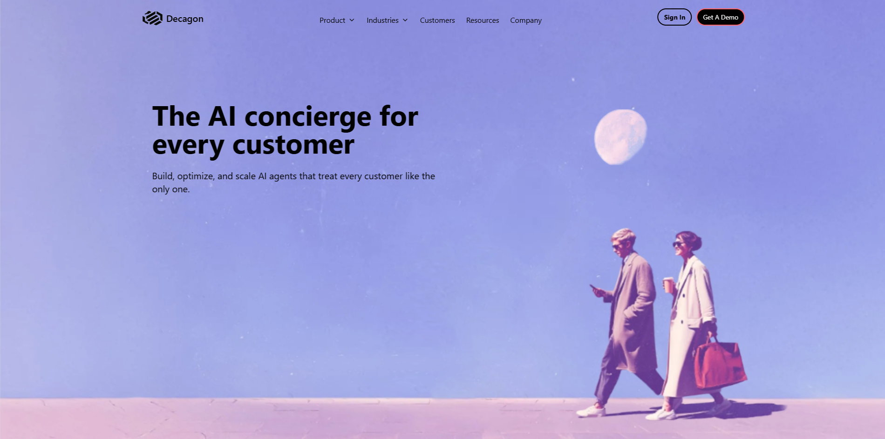
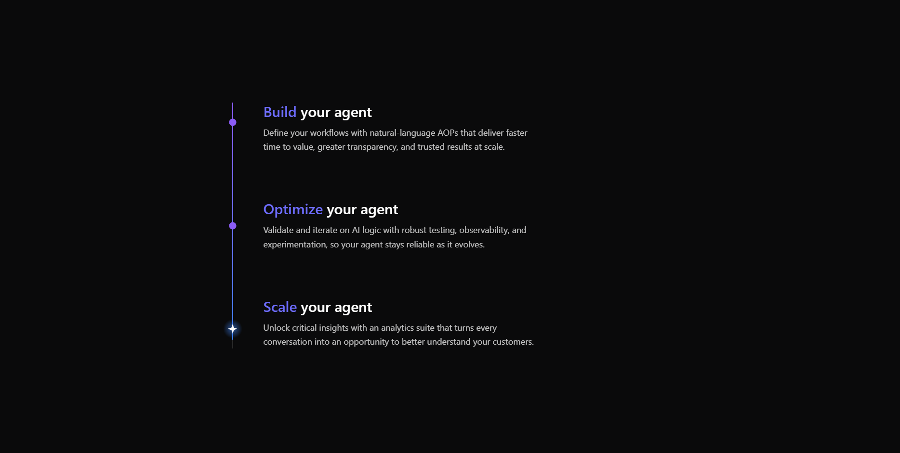
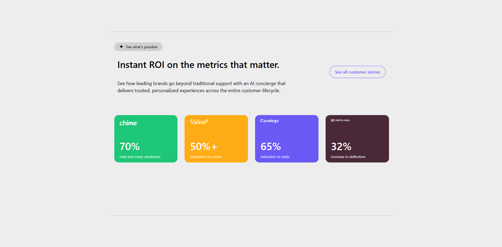

# Decagon-Clone | AI Concierge Landing Page

A fully responsive, interactive landing page clone of Decagon's marketing site — built entirely with vanilla JavaScript, Tailwind CSS, and custom SVG animations. Features a scroll-driven hero carousel, magnetic moon animation, sticky scroll-trio with progress indicators, cross-fading accordion showcase, and a polished 100vh developer footer.

 <p dir="rtl" align="right">
 یک نسخه بازسازی‌شده از Landing page وب‌سایت بازاریابی Decagon با طراحی کاملاً Responsive و تعاملی؛ ساخته‌شده به‌طور کامل با JavaScript(vanilla), Tailwind CSS و انیمیشن‌های اختصاصی SVG. این صفحه شامل اسلایدر Hero مبتنی بر اسکرول، انیمیشن مغناطیسی ماه، بخش سه‌گانه با اسکرول چسبان و نشانگرهای پیشرفت، بخش آکاردئونی با افکت محوشدن و ظاهرشدن تدریجی (Cross-fade) و یک فوتر حرفه‌ای مخصوص توسعه‌دهندگان با ارتفاع کامل صفحه (100vh) است.
 </p>

## Table of Contents
- [Demo](#demo)
- [Features](#features)
- [Screenshots](#screenshots)
- [Tech Stack](#tech-stack)
- [Project Structure](#project-structure)
- [Author](#author)

## Demo
[Live Demo](https://ali-mirzaei-dev.github.io/Decagon-Website//)

## Features

- **Scroll-Driven Hero Carousel | اسلایدشو چرخان اسکرولی:**

  <p dir="rtl" align="right">
  یک بخش هیرو با ارتفاع ۳۰۰vh که با اسکرول عمودی، تصاویر به‌صورت افقی جابه‌جا می‌شوند. هر تصویر کپشن اختصاصی خود را دارد که با انیمیشن scale وارد می‌شود و با پارالاکس به‌صورت نرم جابه‌جا می‌شود.
  </p>

- **Magnetic Moon Animation | انیمیشن مغناطیسی ماه:**

  <p dir="rtl" align="right">
  تصویر ماه با حرکت موس (±20px) و اسکرول در یک مسیر منحنی هماهنگ حرکت می‌کند. ابتدا بالا می‌رود، در نقطه اوج کمی جلو می‌رود و سپس آرام پایین می‌آید و در پایان هیرو در جای خود می‌ماند.
  </p>

- **Sticky Scroll-Trio with Progress | بخش سه‌گانه با نوار پیشرفت:**

  <p dir="rtl" align="right">
  سه کارت Build، Optimize و Scale که با اسکرول، یکی‌یکی با انیمیشن opacity و translateY ظاهر می‌شوند. یک نوار پیشرفت عمودی با دو دایره و یک ستاره در پایان روشن می‌شوند.
  </p>

- **Cross-Fade Accordion | آکاردئون با افکت محو‌شدگی:**

  <p dir="rtl" align="right">
  بخش Build once, Deploy everywhere با سه گزینه Voice، Chat و Email که با hover، تصاویر مربوطه با افکت cross-fade نرم جایگزین می‌شوند — بدون تغییر ناگهانی.
  </p>

- **Brand Cards Showcase | ویترین برندها:**

  <p dir="rtl" align="right">
  چهار کارت رنگی با آمار برندها (Chime، Valon، Curology، Rippling) که در موبایل به‌صورت ۲ ستونی و در دسکتاپ به‌صورت ۴ ستونی نمایش داده می‌شوند.
  </p>

- **Custom Toast System | سیستم اعلان سفارشی:**

  <p dir="rtl" align="right">
  تابع <code dir="ltr">toast()</code> دینامیک که فقط یک اعلان همزمان نشان می‌دهد — با پشتیبانی پیام‌های success (سبز) و error (قرمز).
  </p>

- **Logo Carousel with Auto-Advance | چرخش لوگو با پیشرفت خودکار:**

  <p dir="rtl" align="right">
  چرخش لوگوها با انیمیشن مرز بالایی ۱۰ ثانیه‌ای که پس از پایان انیمیشن به‌صورت خودکار به لوگوی بعدی می‌رود. ناوبری با کلیدهای چپ و راست.
  </p>

- **Fully Responsive | کاملاً واکنش‌گرا:**

  <p dir="rtl" align="right">
  طراحی موبایل-اول با breakpointهای دقیق برای تبلت و دسکتاپ. همه‌ی بخش‌ها در تمام اندازه‌ها به‌خوبی نمایش داده می‌شوند.
  </p>

## Screenshots

<table>
  <tr>
    <td width="33%">
      
    </td>
    <td width="33%">
      
    </td>
    <td width="33%">
      
    </td>
  </tr>
  <tr>
    <td align="center"><b>Hero Carousel</b></td>
    <td align="center"><b>Sticky Scroll-Trio</b></td>
    <td align="center"><b>Brand Cards Showcase</b></td>
  </tr>
</table>

## Tech Stack

| Technology | Purpose |
|---|---|
| HTML 5 | Semantic markup & DOM structure |
| Tailwind CSS | Utility-first styling, responsive layout, custom arbitrary values |
| JavaScript (Vanilla) | Scroll animations, DOM manipulation, magnetic moon, custom toast |
| SVG | Progress line, circles, star with gradient fills |

## Project Structure

```text
Decagon-Clone/
│
├── assets/
│   ├── Images/
│   ├── Font/
│   │ 
│   ├── JavaScript/
│   │   └── main.js                     
│   │ 
│   └── StyleSheet/
│       ├── master.css                
│       └── output.css         
│
└── index.html
```

## Author

**Ali Mirzaei** – Frontend Developer

- [GitHub](https://github.com/ali-mirzaei-dev)
- [LinkedIn](https://www.linkedin.com/in/ali-mirzaei-dev/)
- [Instagram](https://instagram.com/ali.mirzaei.dev)
- [ali.mirzaei.kt@gmail.com](mailto:ali.mirzaei.kt@gmail.com)
